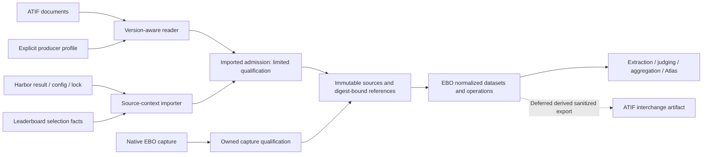

# ATIF imports and EBO v2

Status: accepted architecture with an additive 1.x implementation on develop.
The [ADR](atif-adoption-adr.md) records the decisions and the
[pilot report](atif-import-pilot.md) records the measured limits.

## Release decisions

| Slice | Result | Release path | Planning size |
| --- | --- | --- | --- |
| Compatibility guard | Separate capture-time adapter identity from normalizer version; preserve base readback | 1.x | 3 points |
| Ordering correction | Source-local precedence; unavailable when unknown; occurrence rules 1.2.0 | Independent 1.x corrective release | 5 points |
| Inspect and Pi import | Version policy, profiles, imported manifest, source-bound projection | Additive 1.x | 13 points across reader and Pi admission |
| Harbor and leaderboard import | Repeated acquisition, attempt/revision/assessment identity, provenance-aware cohorts | Additive 1.x | 13 points |
| EBO v2 normalization | Typed operations, coverage, clocks, consumer migration and compatibility reader | 2.0 | 24 points across contracts, adapters and consumers |
| EBO ATIF export | Consumer-specific derived output and declared losses | Deferred | Estimate after consumer selection |

Points express relative implementation scope. Paid judging has a separate
budget; the pilot used zero model calls. The canonical planning wave is
`Anthropic-evals/plans/waves/ebo-v2-atif` in the benchmarking workspace.

EBO retains engineering-agent evidence and evaluates behavior. Harbor runs
benchmark trials and converts several agents' logs into ATIF. The Harness
Leaderboard publishes trial records and trajectories. EBO's structural
extractors measure recorded facts, judges produce cited interpretations, and
Atlas presents those results. Uniform events are EBO's source-bound observation
projection; they are not the harness transport protocol.

## Scope and architecture

The first product path admits existing evidence for analysis. EBO's rejected
`imported-trajectory` execution policy concerns prior context supplied to a new
agent run. Analysis admission does not enable that policy. Queue compilation
must also reject a task-shipped `trajectory.json` while seeded execution is
unsupported, including under the current Harbor pin.



Three components have separate owners and tests:

* The **ATIF reader**, owned by EBO's ingestion maintainer, preserves the bytes,
  validates structure/version features, and exposes JSON-pointer records. It
  never assigns benchmark outcomes or executes content.
* The **producer-profile registry**, owned by EBO's adapter maintainers, defines
  converter-specific interpretation. Every supported Harbor release requires a
  profile review and fixture run before admission. The registry is explicit
  code/configuration with a digest, not a dynamic plugin loader.
* **Source-context importers**, owned by EBO's Harbor integration maintainer,
  bind trials, assessments and cohort membership to those records. The
  leaderboard importer additionally resolves reuse, selected attempts,
  exclusions and protected-versus-agent-writable metering records.

`importAtif(source, supportingArtifacts, producerProfile)` returns the existing
`RetainedBehaviorEvidence` abstraction with generalized outcome records. It
does not manufacture a Claude-shaped capture. No analytical consumer imports
ATIF types. Each product task names its owning role; a named maintainer and
reviewer are assigned when the task enters implementation.

The additive path extends that abstraction with an imported normalization input
whose qualification is `imported`. A dedicated imported-dataset constructor
checks its import manifest, profile and source bindings, then uses the existing
normalized-dataset validator. It does not pass an import through the
`describeNormalizedDataset` owned-capture gate by relabelling it `qualified`.
The Pi importer admits source-bound datasets through that path. The frozen fixture corpus and independent converter comparisons gate its supported profiles.

## Implementation state

The 1.x path includes frozen fixture gates, independent capture/normalizer
versions, occurrence rules 1.2.0, ATIF v1.2-v1.8 inspection, two pinned Pi
profiles, imported admission, source-bound citations, Harbor execution and
assessment lineage, origin-separated aggregation/Atlas and supplemental evidence
companions. Imported evidence contributes zero to capture-qualified rates.

Two shipped frozen 1.x runtimes and optional Atlas cohort pins preserve exact
source/runtime receipts. Each snapshot is reproducible and verified before
loading. The original 1.4.0 runtime reproduces native observation digests; the
additive runtime includes source-local ordering and imports. The explicit
[v2 analytical contracts](normalization-v2.md) are implemented. Native v2
adapter and consumer activation retain separate gates. Default native
normalization remains v1.

The retained native fixture inventory checks 144 bundle paths: 66 accepted
bundles representing 41 distinct normalized datasets and 78 rejected bundles.
The accepted dataset digests and rejection boundaries remain stable. The
production Pi importer passes 41 independent native/converter pairs, including
declared source losses. Existing packet and RO-Crate verification passes.

Full study migration requires dependency-level accounting and a separately
approved budget for any model judgments. Additional producer profiles require
their own fidelity gates. Release qualification and publication follow those
gates.

## Version and producer admission

The initial version table covers ATIF-v1.2 through v1.8. Earlier versions and
v2 drafts return explicit unsupported-version diagnostics. Structural checks
run in a pinned Harbor subprocess; EBO separately enforces field-introduction
rules. Relabelling a v1.7 file as v1.2 must fail EBO's version gate even if
Harbor's current model accepts it. `llm_call_count` is untracked below v1.7.
Pre-v1.7 subagent references require version-specific handling; unresolved
session-only references remain unavailable.

A profile key records converter identifier and revision, ATIF version, agent
name/version, and Harbor version when independently established. An absent
Harbor version stays unknown. The sampled `lock.json` files contain no
`harbor_version`, so lock presence alone cannot establish the converter build.
The pinned source/configuration receipt can provide additional provenance.

Profiles declare call/result correlation, error fields, cache accounting,
subagent and summarizer scope, zero-fill behavior, branch selection, inference
count semantics, and completeness markers. An unregistered profile permits
structural inspection; behavioral measures are unavailable with
`PRODUCER_CONVENTIONS_UNREGISTERED`.

`atif-scan` supplies an optional, pinned integrity/ending classifier and a
differential reader oracle. Its analysis view cannot replace byte retention,
full version validation or native-companion fidelity checks. Scanner findings
are third-party observations, with scanner version and source digest; they are
review candidates rather than verdicts. The pilot used 0.8.21. Existing board
0.7.3 records retain their original scanner identity.

## Identity and retained contracts

The new `ebo.import-manifest/v1` records:

```ts
type ImportManifest = {
  schemaVersion: "ebo.import-manifest/v1";
  attemptId: `harbor-trial:${string}`; // TrialResult.id, never ATIF session_id
  runId: string; // Proven original executor; unresolved identity stays inspect-only
  originalRun: EvidenceValue<string>; // Earliest proven executor via reuse lineage
  captureRevision: `sha256:${string}`;
  origin: { kind: "imported"; producerProfileDigest: string; converter: string };
  qualification: { status: "imported"; reasons: string[] };
  artifacts: RunBundleEvidenceDescriptor[];
  assessments: AssessmentReference[];
};
```

`captureRevision` hashes a canonical, path-sorted list of retained trajectory
and native-artifact byte digests. Acquisition time, board membership and file
location are excluded. Reimporting identical bytes is a no-op. Changed bytes
create a new immutable revision of the same attempt. A regrade is a new linked
assessment; a new Harbor UUID alone does not establish a new agent execution.
The importer verifies the regrade relationship before joining it. Missing or
conflicting identity evidence blocks pooling rather than guessing.

Leaderboard run/stage/attempt selection is a separate cohort-membership
artifact. It includes the board-code revision, facts digests, `ATTEMPTS`, reuse
chain, exclusions and selection time. A trial reused in several board runs is
one attempt with several memberships. `agent_info.name == "ebo-native"`
requires an owned-bundle binding or is rejected as duplicate admission.

`ebo.evidence-companion/v1` is the shared extension for additional evidence on
an existing attempt. It binds the original manifest digest, source ranges,
producer and policy digests, artifact digests, and permitted supplemental
observations. Harbor conversion of an owned Pi run is a companion. A leaderboard
trial is a non-owned imported attempt. Workspace history can use the same
binding contract when separately implemented. A companion creates no trial or
duplicate native events. The history-system proposal remains specification-only;
this wave implements no history collector or source-derived history code.

Keep raw-file SHA-256 and upstream xet hashes separately. JSON-pointer
citations hash the canonical pointed value. Record lookup uses the longest
matching containing pointer, including nested subagents and oversized result
records. Retain continuation files as separate artifacts. The frozen v1 reader
preserves its historical digest rules; v2 never silently reinterprets them.

## Qualification and comparison

`imported` is a separate class and contributes zero to capture-qualified rates.
Its default reason is `EVENT_LOG_COMPLETENESS_UNPROVEN`. A structurally valid
file never upgrades native qualification. An ATIF companion inherits the owned
capture's limits. Readability, completeness, execution termination, task reward,
and source integrity remain independently reportable.

Completeness evidence includes trial result/timing/exception records, native
logs, pending calls, branch coverage, usage reconciliation, and producer
partial/rebuilt/unparsed markers. Agreement supports only the declared surfaces;
it cannot prove omitted surfaces were complete. Record agent-writable files and
EBO-observed protocol streams as distinct integrity classes. The leaderboard's
protected record copy and its `shrunk` flag are separate from the agent-writable
usage log. Neither a clean scan nor `shrunk: false` proves faithful capture.

Aggregation groups imported and owned evidence separately by `evidence-origin`.
Comparison blocks on `evidence-origin-mismatch` unless an explicit,
per-measure/per-profile instrument-invariance gate has passed. A declared
harness difference does not waive origin, budget, fixture or policy gates.
Capture-profile identity includes profile/converter/Harbor/importer versions;
fixture identity uses task commit/checksum; budget uses recorded limits; model
configuration includes observed effort sent. Unknown conditions stay unknown.
Atlas and packets expose origin and qualification.

## Measurement rules

| Measure | Admission rule |
| --- | --- |
| Recorded tool operations | Correlate document-scoped `tool_call_id`; preserve null/unmatched results and pending native calls |
| Tool failure | Apply the registered producer's explicit error/status fields; absent status is unknown |
| Native request count | Require retained source-native request identities; never create them from step positions or `api_call_N` |
| Declared inference count | Sum tracked `llm_call_count` over included, non-copied scopes; any untracked included step makes it unavailable |
| Proxy calls and usage | Retain as proxy-metered measures; reconcile without substituting for harness-reported measures |
| Input tokens | Record inclusive/exclusive cache semantics; Pi uncached input = prompt minus cache read minus cache write |
| Final usage | Reconcile step, continuation, child and final scopes; emit at most one final per selected authority/scope |
| Failure response | Require a later issuing inference with evidence of the failure; same-inference sibling calls cannot be responses |
| Context | Interpret declared transformation type/boundary; distinguish summarizers, delegation and conversion-inserted gap steps |

ATIF step ordinal is source order within its document. Every event projected
from a step shares that ordinal. ATIF v1 has no per-call start/result clock.
Never synthesize millisecond offsets or call execution sequence from arrays.
Copied context contributes no new actions or usage. Gap text is a completeness
limitation. A compaction event without replacement-boundary evidence permits a
compaction observation, while effective-context reconstruction stays unavailable.

Pi's prompt count includes cache reads and writes. Cache-write absence cannot
be replaced with zero unless the registered producer and native comparison
establish that convention. Unknown zero-filled source metrics remain unknown.
Parent totals that include descendants cannot be added to child totals.

In the additive 1.x path, incomplete positive counts are reported separately as
recorded lower bounds in import diagnostics and withheld from exact attempt
measures. EBO v2 introduces an explicit lower-bound measurement value. This
avoids changing existing v1 observation shapes or silently treating partial
positive counts as full attempt totals.

## EBO v2 normalized contracts

EBO owns `ebo.normalized-dataset/v2`, `ebo.uniform-event/v2`, and the new
`ebo.operation/v1` derived projection. `RetainedBehaviorEvidence` gains a
versioned outcome union for native terminal/workspace/verifier records and
Harbor trial/reward records. Format reader and producer identity are independent
of executed harness identity. Imported-profile harness namespaces can bridge
the existing 1.x registry; v2 represents those axes explicitly.

An operation has a document/session-scoped identity and records its source
identity class, call/result event IDs, tool name, input digest, failure as
`EvidenceValue<boolean>`, issuing inference, and start/end order evidence.
Request, delegation and tool operation kinds are distinct. Every adapter
supplies operation scope; consumers stop resolving native ID aliases.

`precedes(a, b)` returns before, after, same observation, or unknown. It compares
ordinal positions only in an established common order domain. Clock evidence
records clock kind, domain, provenance and precision; receipt clocks are not
execution clocks. Display sorting has a separate deterministic tie-breaker.
The v1 corrective release applies the safe ordering rule first, preserves
legacy readback, and labels execution-only follow-up interpretation as heuristic.

Message completeness, context transformation, operation status and resource
scope move from consumer heuristics to adapter-owned typed facts. Adopt ATIF's
precise inference and context vocabulary where applicable. Keep capture
authority, source digests, coverage and comparison policy in EBO's contracts.

## Retention, limits and sharing

Import is closed-world: no reference-triggered network fetch, absolute path,
parent traversal or symlink resolution. Missing media/subagent files remain
unavailable. Explicit acquisition is a separate bounded operation. Hash every
retained attachment; binary media stays outside judges and shareable packets
until an explicit policy supports it.

The first reader caps documents at 64 MiB and emits pointer-level records with
field-level analysis caps. Oversized input preserves the attempt and descriptor
with `OVERSIZED_ARTIFACT`; it does not crash the corpus or claim zero activity.
A streaming implementation is a later measured optimization, not a prerequisite
for the sampled files. Token-ID/logprob arrays remain in restricted raw evidence
and are represented by digest/size outside it. They are excluded from judge and
shareable views. Profiles identify additional reasoning fields.

Run EBO secret scanning at admission and retain finding counts and policy
receipts. Preserve raw bytes in restricted storage; do not claim that a text scan
certifies token arrays or unknown extensions. Source URL, retrieval time, stated
terms, xet hash and attribution accompany every import. Unstated dataset terms
keep the source restricted. Source refresh/takedown quarantines affected
revisions and invalidates derivatives; sharing requires independently established
redistribution terms. Public synthetic and licensed upstream fixtures are the
CI corpus; retained study pairs remain in a private test lane.

## Compatibility, cost and rollout gates

Separate capture-time adapter versions from normalizer versions before changing
Pi or Factory constants. Preserve every base-loadable fixture after each slice.
The pilot currently establishes two accepted and one rejected local Pi baselines;
the review's 47-of-124 inventory must be reproduced and frozen before claiming
the complete readback gate.

The v2 compatibility reader dispatches on supported artifact and producer
versions. It is shipped and reviewed code; packets never supply executable
reader code. Old packet verification uses its original RO-Crate/digest rules.
Current analysis can regenerate new outputs beside old ones. Cross-cohort Atlas
views retain each cohort's analysis-runtime identity and gate comparability.

Inventory distinct assertion content and attempt/dimension/evaluator identities
before budgeting migration. The pilot's inventory is deliberately bounded to two
study roots and is not a workspace census. A changed dataset invalidates bound
assertions. A changed occurrence ledger invalidates its ratings and ledger-mode
judgments. Unchanged dependency digests preserve reuse. Local re-normalization
and paid re-judging have separate receipts.

Budget formula: affected distinct assertions multiplied by measured cost per
judgment. A 5,346-attempt, eight-rubric scenario is 42,768 invocations before
retries; it is not an approved study. The pilot authorizes zero paid judgments.
A later semantic pilot selects at most 12 attempts stratified by task, harness
and outcome, with two named dimensions and a separately supplied spending cap.
Collect every model/route alias from run/config/result/trajectory records for
blinding. Parallel execution changes elapsed time, not the number of judgments.

Release gates are: version conformance; per-producer fidelity; per-extractor
equivalence; native readback; packet verification; origin-separated aggregation;
and independent review of the exact release artifact. Passing a self-authored
export/import round trip never substitutes for independent converter equivalence.

## Upstream alignment and prior designs

The [open ATIF v2 RFC](https://github.com/harbor-framework/harbor/pull/4134)
adds ATIF-E streaming, actions with timing/error/approval fields, lineage and
namespaced extensions. This wave pins draft head
`d618a647c938e2d5fdfa3a9e3245fb08f53db259` as research evidence. Before freezing
EBO v2, map its requirements against that draft and the then-current accepted
specification. Reconsider a shared event representation if it preserves EBO's
ordering, unknown values, authority and citation requirements. Prepare upstream
feedback locally; posting requires an explicit communication instruction.

The baseline policy is Harbor Migration Spec section 13 in the existing local
planning archive. The supplemental-evidence binding follows the specification-only
2026-10-25 open-history proposal's EBO boundary and V30-V32 cases; no history
implementation or provenance clearance is inferred. The canonical planning wave
contains the complete review-disposition matrix and implementation tasks.

Pinned source references:

* [EBO base contracts](https://github.com/kumanday/engineering-behavior-observatory/blob/86a601079a51243756fe52798365a9cbf69cfe6f/src/uniform-events.ts#L29)
* [Leaderboard producer conversion](https://huggingface.co/spaces/joelniklaus/harness-leaderboard/blob/c4a8c4cb468aa1b1e8f3e31c002d2272cc090236/hlb/harbor_ext/trajectories.py)
* [ATIF v2 draft](https://github.com/mbleigh/harbor/blob/d618a647c938e2d5fdfa3a9e3245fb08f53db259/rfcs/0004-trajectory-format-v2.md)
