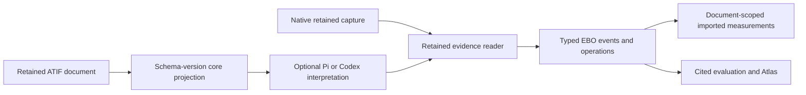

# EBO v2 source interpretation design

EBO retains native evidence and ATIF source documents, then derives typed events,
operations and measurements for analysis. Native capture qualification and
third-party import qualification remain separate. Consumers share the retained
evidence reader and citation resolver.

## Core and interpretation

The core maps standard ATIF steps, sources, messages, calls, linked results,
observations, declared metrics, inference counts, copied context, subagent
histories, continuations and media references. Extensions remain retained and
uninterpreted. Missing evidence remains unknown. Every imported measurement is
scoped to its recorded document; no document count establishes attempt
completeness. Results folded into issuing steps have unknown arrival order.

Optional overlays interpret measured converter extensions and defects. Pi and
Codex are the initial overlays. They match agent-name/version-range and
converter-ID/version-range rules, with optional operator context. Unknown
versions reduce confidence without removing core content or counts. Each
adjustment has a reason and evidence pointers. Other producers use core.

EBO owns structural validation. Known v1.2–v1.8 documents use their version's
semantics; future v1 minors use the latest known minor and retain unfamiliar
fields as unmapped. Unsupported major versions receive a specific diagnostic.
Harbor validation is an optional cross-check with its installed version recorded.

## Native evidence reading

EBO maintains Claude Agent SDK, Codex, Devin CLI, Cursor, Pi, Factory Droid,
OpenHands and DeepSeek Harness. Retained evidence from unfamiliar runtime or
capture-adapter versions is read through each adapter's format contract with a
version-confidence limitation. Version disagreement remains visible as a
conflict. Actual malformed data, digest corruption and contradictory session or
execution identities receive specific diagnostics. Version metadata remains a
cohort dimension; mixed-version comparisons are qualified.

[Harness guides](../harnesses/README.md) describe the native surfaces. The
[ATIF coverage matrix](../reference/atif-harness-coverage.md) records upstream
converters, public fixtures, real same-run conversions and measured losses.
Claude Code versus Agent SDK and Cursor CLI versus Cursor SDK are explicit
surface differences. Factory Droid and DeepSeek authored ATIF selections bind
actual retained capture content and are labelled as authored evidence.

## Digests and migration

Raw sources, old manifests, packets and the qualified rc.1 archive remain
immutable. New imports use `ebo.import-manifest/v2`, which binds source and
inspection digests, document-derived producer declarations, optional operator
context and admission overlay IDs/digests. An interpretation receipt binds core, compatibility projection
and overlay implementation identities. Existing v1 admissions reopen through
the current reader while retaining their admission profile data.

A changed core, overlay, native reader or contract changes the derived dataset
identity. Reopening reports admission and current interpretation identities;
it does not require an exact-fingerprint registry match. Source corruption still
fails readback. Observation, ledger, rating and assertion dependencies must be
reconciled before reuse. Old derivations remain available through frozen
compatibility readers. No repair silently re-judges evidence.

The rc.1 package is a frozen compatibility artifact. Development repairs produce
new derivations; rc.2 qualification follows the runtime milestone and uses a new
source and fixture pin. [Migration accounting](migration-accounting.md) owns
dependency inventories and selective regeneration.

## Runtime milestone

Reading evidence is independent of selecting a runtime for a new study. The
runtime milestone resolves the newest stable release at least 24 hours old by
default, with study/harness overrides and explicit reproduction versions. The
study freezes exact versions, integrity hashes, provenance and security receipts.
All arms, reruns, Harbor guests and the Codex judge consume that lock and record
actual probed runtime versions. A probe/lock disagreement prevents execution.

Per-study SDK installations keep study runtimes isolated and reproducible across
Agent SDK, Cursor, Pi, Droid and DeepSeek. This costs installation and API
conformance work; automated package bumps alone cannot preserve independent
study compositions. Format confidence is not a runtime version allowlist.

The resolver excludes deprecated releases from default selection. A deprecated
frozen or explicit reproduction release warns and runs; yanked, unpublished or
malicious-flagged releases block. OSV queries run at resolution and before each
launch for every locked component. Malicious-package entries block; other
advisories remain recorded warnings. Content-addressed installs verify exact
artifacts and offered provenance, with install scripts disabled where feasible.

`ebo.study-runtime-lock/v1` binds the study request, selection clock, cutoff,
component versions, complete dependency graphs and installation receipts. Its
digest identifies the frozen composition. A changed request creates a new study
revision. Reading the freeze does not resolve releases again.

Each launch receipt binds that lock digest to fresh withdrawal and OSV checks.
SDK modules load from the selected content-addressed directory. Package metadata
and executable or server probes identify the actual runtime; probe disagreement
stops execution. `run-manifest/v2` retains the lock and launch receipt as internal
runtime diagnostics and binds their digests. The v1 reader remains available for
existing bundles.

Harbor's host-side Python environment and its Linux harness worker have distinct
platform and ABI identities in the study composition. Packaging a worker must
use its frozen dependency graph and exact Node image, while the Harbor/Smol
controller uses the frozen host composition.
