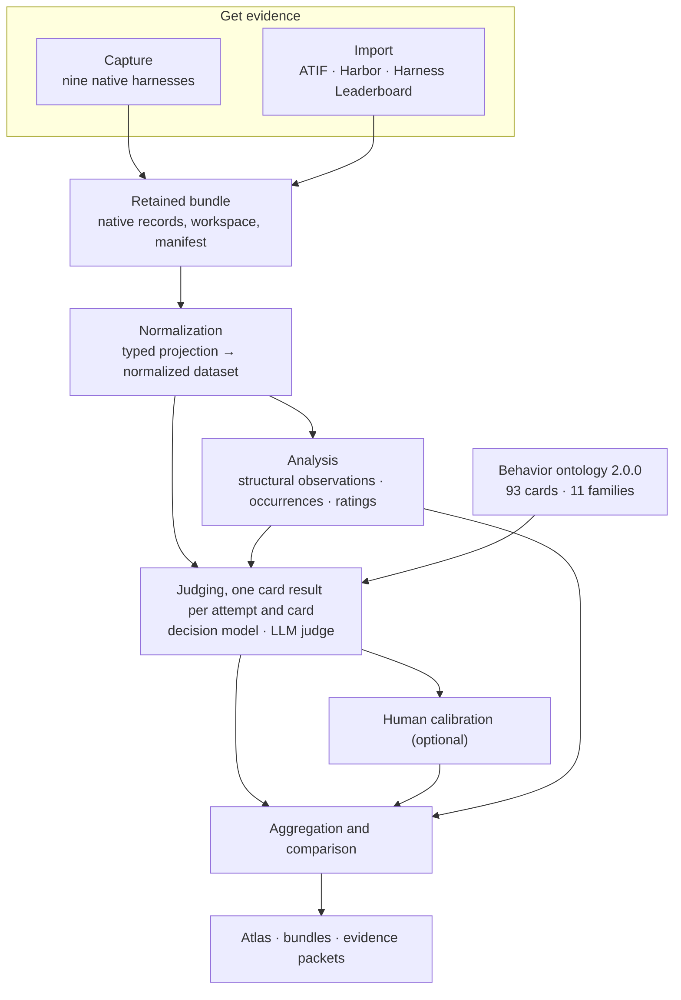

# Map of EBO 2.0

This page is the overview of EBO 2.0: what it does from capture to report,
which record each step writes, what changed from 1.x and what is planned for
later. It describes the code as merged. Each section links to the guide or
reference that holds the details.

## What EBO does

EBO records how an engineering agent works on a task and ties every
behavioral finding to the native records behind it. The work runs in eight
steps.

### 1. Capture and import

A capture runs one attempt of a frozen task through a harness and retains its
native trajectory and workspace outcome in a run bundle (`run-manifest/v2`).
EBO captures nine harnesses natively: Claude Agent SDK, Codex, Devin CLI,
Cursor, Pi, OpenHands, DeepSeek Harness, Factory Droid and Google Antigravity
CLI. [Choose a harness](../harnesses/README.md) compares what each one
exposes. Every CLI capture runs inside a
[study runtime](../reference/study-runtimes.md), which freezes the exact
software versions and records the software that actually ran.

Harbor tasks run in containers on Smol machines, locally or on Smol Cloud,
with EBO workers driving the harness inside each trial
([Harbor tasks](harbor-tasks.md)).

An import brings in trajectories EBO did not capture:

- [ATIF](../reference/atif.md) from any conforming producer, read through a
  producer-independent core with optional Pi and Codex overlays.
- [Harbor source imports](../reference/harbor-imports.md), with execution
  identity and separate assessments.
- [Harness Leaderboard cohorts](../reference/leaderboard-imports.md), pinned
  to a snapshot receipt.

Imported evidence keeps its own qualification class. It is analysed, judged
and shown in Atlas, and it never counts toward capture-qualified rates.

[Open Responses through Pi](../harnesses/open-responses.md) records
Responses-style endpoints on the wire and checks them against the
specification.

### 2. Normalization

Native records stay authoritative. Normalization adds a uniform view on top
of them in two layers:

- The **typed projection** (`ebo.typed-dataset/v1`, `ebo.typed-event/v1`,
  `ebo.operation/v1`) is the stricter evidence model. Every native record has
  a mapping disposition. Each operation has a required scope and a single
  identity. Failure is known, unknown or unsupported. Clocks state their kind,
  domain and precision. Counts are exact, lower bounds or unavailable, with
  the population they cover. ATIF imports are projected into it first, and
  harness verification reads it.
- The **normalized dataset** (`ebo.normalized-dataset/v1` with
  `ebo.uniform-event/v1`) is what analysis, judging and Atlas read. For ATIF
  imports it is computed from the typed projection.

[Normalization integrity](../evaluation/normalization-integrity.md) and the
[typed evidence projection](../development/normalization-v2.md) define the
guarantees: missing evidence stays explicit, nothing is invented, and every
derived event resolves to the native record it came from.

### 3. Analysis

- [Structural observations](../evaluation/structural-observations.md) are
  counted facts with citations, such as tool operations, failures followed by
  a retry, or whether a check ran after the last edit.
- Occurrences are individual instances, each citing exactly its own events.
- [Occurrence ratings](../evaluation/occurrence-ratings.md) answer fixed
  questions about one occurrence with a rating model and keep failed or
  uncertain answers visible.

### 4. Judging

A judgment names one card of the behavior ontology and gives a verdict for one
attempt: `present`, `absent` or `unknown`, plus one named value on a dimension
card that is present. Both judging modes write the same record,
[`ebo.behavior-assertion/v2`](../evaluation/behavior-assertions.md), which
names its producer mode. No report pools the two modes.

| | Decision model | LLM judge |
| :--- | :--- | :--- |
| Reads | Every recorded step, each field cut to a fixed length | A selection of events, within stated limits |
| Returns | Probabilities, and the thresholds that turn them into a verdict | A verdict with cited events, a rationale, an alternative explanation and a confidence |
| Abstains with | `unknown`, when the probability lies between the thresholds | `unknown`, with a reason |
| Suited to | Volume: whole cohorts | Audits that need the cited steps |

[Decision-model judging](../evaluation/decision-model-judge.md) is the
suggested mode for cohorts. `ebo judge decision-model` judges every attempt in
a corpus, asks the cards in batches, resumes after an interruption and can take
the cards a few at a time. `ebo judge decision-model import` validates and
writes results produced by another pipeline into the same record. The LLM judge
runs through `ebo judge prepare|run|batch`
([semantic judging](../evaluation/semantic-judge.md)). It sees a selection of
an attempt's events, not the whole attempt, and its rationale is model text
backed by citations that must resolve to retained records.

### 5. The behavior ontology

The [EBO behavior ontology 2.0.0](../evaluation/behavior-ontology.md) is the
vocabulary every judgment uses: 93 cards in 11 families.

- **Workflow** cards (25) describe a common practice.
- **Dimension** cards (29) describe a situation with several named outcomes.
- **Finding** cards (39) describe a specific situation.

Each workflow and finding card, and each value of a dimension card, has a
fixed direction: `favourable`, `unfavourable` or `neutral`. No judge decides
it and no result stores it. The [reference page](../reference/behavior-ontology.md)
lists every card.

### 6. Aggregation and calibration

[Aggregation](../evaluation/aggregation.md) groups attempts by task, model,
harness or trial. It reports each card's verdict distribution per producer,
the direction shares, and matched comparisons that pass an eligibility gate.
Every number states its population, denominator and exclusions; nothing is
ranked or called significant.

[Human calibration](../evaluation/human-calibration.md) is optional. It samples
results per card and per mode, records reviewer decisions with their lineage,
and reports judge-human agreement per mode.

### 7. Atlas, bundles and packets

- The [Behavior Atlas](atlas.md) is a local, filterable view of a cohort with
  drill-down from every number to the cited native record. It also serves
  Grafana panels and static HTML reports.
- [Atlas bundles](../evaluation/atlas-bundles.md) are the tables behind the
  interactive viewer: card by arm, one producer mode at a time.
- [Evidence packets](../evaluation/evidence-packets.md) are verified folders
  for partners, in internal, partner and restricted variants.
- [Portable exports](evidence-and-sharing.md) are policy-checked archives of
  run bundles.

## Record formats

Every record names its format and version in `schemaVersion`. A format's
number states its shape: when the shape changes, the number changes. EBO 2.0
reads and writes one version of each format, and a file with any other name or
number fails with "Unsupported schema version." Different kinds of document
have different names.

Schema file names (`schemas/*.v1.json`) version the schema document, which can
hold several formats. The format name inside each record is what counts.

"Operator-authored" means a person writes the file. Records that only appear
nested inside a larger document are listed with it. Reader lists for widely
used formats are shortened.

### Task and study setup

| Format | Written by | Read by | What it is |
| :--- | :--- | :--- | :--- |
| `ebo.task-packet/v1` | operator-authored | `ebo task-packet validate\|admit\|freeze` | Task definition: prompt, workspace, verifiers |
| `ebo.task-packet-freeze/v1` | `ebo task-packet freeze` | `ebo task-packet status`, `ebo matrix compile` | Frozen packet digests |
| `ebo.task-packet-experiment/v1` | operator-authored | `ebo matrix compile`, `ebo queue validate` | Task × model × harness matrix over task packets |
| `ebo.task-packet-queue/v1` | `ebo matrix compile` | `ebo queue inspect\|validate`, `ebo <harness> run`, `ebo runtime bind-queue` | Compiled queue of task-packet runs |
| `ebo.harbor-experiment/v1` | operator-authored | `ebo harbor compile` | Matrix over admitted Harbor tasks |
| `ebo.harbor-queue/v1` | `ebo harbor compile` | `ebo harbor run`, `ebo harbor environment serve`, `ebo runtime bind-queue` | Compiled queue of Harbor trials |
| `ebo.harbor-snapshot-manifest/v1` | `ebo harbor prepare` | `ebo harbor admit\|freeze\|status` | File manifest of a retained task snapshot |
| `ebo.harbor-admission/v1` | `ebo harbor prepare`, `ebo harbor admit` | `ebo harbor freeze\|status` | Harbor task admission |
| `ebo.harbor-review/v1` | operator-authored | `ebo harbor admit` | Human decision on a proposed admission |
| `ebo.harbor-freeze/v1` | `ebo harbor freeze` | `ebo harbor status`, `ebo harbor compile` | Frozen Harbor task binding |
| `ebo.harbor-conversion/v1` | `ebo harbor convert-legacy` | (report only) | Conversion of a task packet into a Harbor task |
| `ebo.study-queue/v1`, `ebo.study-freeze/v1` | `ebo runtime bind-queue` | `ebo <harness> run`, `ebo harbor run` | A queue bound to the study's runtime freeze |

### Runtime and verification

| Format | Written by | Read by | What it is |
| :--- | :--- | :--- | :--- |
| `ebo.study-runtime-lock/v2` | `ebo runtime freeze` | `ebo runtime inspect\|check`, every study-runtime run | Frozen software composition of a study |
| `ebo.runtime-installation/v1` | `ebo runtime freeze` | `ebo runtime check`, every study-runtime run | Receipt for an installed runtime |
| `ebo.runtime-resolution-failure/v1` | `ebo runtime freeze`, on a policy failure | (report only) | Why runtime resolution failed |
| `ebo.runtime-launch/v2` | `ebo runtime check`, every study-runtime run | run-manifest validation | Receipt for one launch, blocked or probed |
| `ebo.local-python-wheels/v1`, `ebo.python-wheel-build/v1` | operator-authored | `ebo runtime freeze` | Locally built wheels and their build provenance |
| `ebo.harness-verification/v1` | `ebo runtime verify` | `ebo runtime verification admit\|inspect`, `ebo runtime freeze` | Harness verification receipt |
| `ebo.harness-verification-candidate/v1` | `ebo runtime verify` | `ebo runtime verification admit` | Verification evidence awaiting review |
| `ebo.harness-verification-admission/v1` | `ebo runtime verification admit\|withdraw` | `ebo runtime verification inspect`, `ebo runtime freeze` | Admission or withdrawal of a receipt |
| `ebo.harness-verification-snapshot/v1` | `ebo runtime freeze`, inside the lock | launch and capture | Catalog state frozen into the study |
| `ebo.run-verification/v1` | every study-runtime capture | `ebo validate`, evidence readers | Verification result for one run |

### Capture

| Format | Written by | Read by | What it is |
| :--- | :--- | :--- | :--- |
| `run-manifest/v2` | every capture | `ebo validate`, `ebo export create`, `ebo corpus build` and others | Run bundle manifest and evidence list |
| `ebo.attempt/v1`, `capture-report/v1`, `ebo.capture-lifecycle/v1` | every capture | `ebo validate`, `ebo runtime verify`, `ebo monitor` | Attempt record, capture qualification, lifecycle |
| `verifier-result/v1` | every capture with a verifier | `ebo validate`, `ebo calibration sample` and others | Verifier outcome and assertions |
| `export-manifest/v1` | `ebo export create` | `ebo validate`, `ebo corpus build\|pack` | Sanitized export of a run bundle |
| `ebo.agent-sdk-config/v1`, `ebo.codex-config/v1`, `ebo.antigravity-config/v1`, `ebo.devin-config/v1`, `ebo.cursor-sdk-config/v1`, `ebo.factory-config/v1`, `ebo.pi-config/v1` | operator-authored | the matching `ebo <harness> run` | Harness configuration referenced by a queue |
| `ebo.agent-sdk-message/v1`, `ebo.claude-agent-hook/v1`, `ebo.agent-sdk-telemetry/v1` | `ebo agent-sdk run` | Agent SDK normalizer | Agent SDK session, hook and telemetry records |
| `ebo.codex-telemetry/v1` | `ebo codex run` | Codex normalizer | Codex telemetry |
| `ebo.devin-telemetry/v1` | `ebo devin run` | Devin normalizer, `ebo export create` | Devin telemetry |
| `ebo.antigravity-runtime/v1` | `ebo antigravity run` | `ebo export create` | Antigravity runtime identity |
| `ebo.factory-runtime/v1` | `ebo factory run` | `ebo export create` | Factory Droid runtime identity |
| `ebo.cursor-native-record/v1` | `ebo cursor run` | Cursor normalizer | Envelope around a native Cursor record |
| `ebo.pi-native-record/v1` | `ebo pi run` | Pi normalizer | Envelope around a native Pi record |
| `ebo.openhands-native-record/v1`, `ebo.deepseek-native-observation/v1`, `ebo.deepseek-runtime-composition/v1` | OpenHands and DeepSeek captures, including Harbor workers | evidence readers, `ebo validate` | OpenHands and DeepSeek native records and composition |
| `ebo.protocol-observation/v1` | process-protocol captures (Codex, Devin, Antigravity and others) | normalizers, capture report | One observed native protocol message |

### Import

| Format | Written by | Read by | What it is |
| :--- | :--- | :--- | :--- |
| `ebo.atif-inspection/v1` | `ebo atif inspect`, `ebo atif import` | `ebo validate`, import reader | Result of an offline ATIF read |
| `ebo.import-manifest/v3`, `ebo.atif-core-mapping/v1`, `ebo.atif-interpretation/v1` | `ebo atif import` | import reader, `ebo corpus build` | Imported bundle manifest, mapping report, interpretation receipt |
| `ebo.atif-overlay/v1` | shipped with EBO; listed by `ebo atif overlays` | `ebo atif import\|import-harbor` | Producer overlay definition |
| `ebo.atif-producer-profile/v1`, `ebo.pi-atif-mapping/v1` | shipped schemas | `ebo validate` | Producer profile and Pi mapping definitions |
| `ebo.harbor-trial-inspection/v1` | `ebo atif inspect-harbor`, `ebo atif import-harbor` | Harbor import reader | Eligibility check of a Harbor trial |
| `ebo.harbor-execution/v1`, `ebo.harbor-assessment/v1`, `ebo.harbor-source-snapshot/v1`, `ebo.harbor-capture-binding/v1`, `ebo.harbor-capture-membership/v1` | `ebo atif import-harbor`, `ebo atif import-leaderboard` | Harbor record reader, `ebo validate` | Imported trial identity, assessment, snapshot and bindings |
| `ebo.leaderboard-cohort-request/v1`, `ebo.leaderboard-acquisition/v1` | operator-authored | `ebo atif import-leaderboard` | Import request and snapshot acquisition |
| `ebo.leaderboard-request-receipt/v1`, `ebo.leaderboard-source-snapshot/v1`, `ebo.import-scan/v1`, `ebo.leaderboard-policy-input/v1`, `ebo.leaderboard-policy-receipt/v1`, `ebo.leaderboard-cohort/v1` | `ebo atif import-leaderboard` | `ebo atif read-leaderboard` | Retained request, snapshot, scan, selection policy and cohort |

### Normalization

These records are built in memory or nested in a dataset; no command writes
them as separate files.

| Format | Built by | Read by | What it is |
| :--- | :--- | :--- | :--- |
| `ebo.typed-dataset/v1`, `ebo.typed-event/v1`, `ebo.operation/v1` | typed projection (native bundles and ATIF imports) | ATIF compatibility view, harness verification | Typed projection: dataset, events, operations |
| `ebo.normalized-dataset/v1`, `ebo.uniform-event/v1`, `ebo.adapter-capability-profile/v1` | harness normalizers and the ATIF compatibility view | observations, judging, Atlas | Normalized dataset that analysis reads |
| `ebo.adapter-coverage-report/v1` | dataset validation | assertion validation | How much of the native record was mapped |

### Analysis

| Format | Written by | Read by | What it is |
| :--- | :--- | :--- | :--- |
| `ebo.structural-observation-set/v1`, `ebo.structural-observation/v1`, `ebo.occurrence/v1` | `ebo observations create\|corpus` | `ebo occurrences rate`, `ebo judge prepare\|run`, `ebo aggregate build` | Structural observations and occurrences of one attempt |
| `ebo.occurrence-ratings/v1`, `ebo.fallback-record/v1` | `ebo occurrences rate` | `ebo judge prepare\|run` | Occurrence ratings, with fallback records |
| `ebo.decision-record/v1` | `ebo occurrences rate`, `ebo claims check` | rating and claim validation | One rating-model request and answer |
| `ebo.claim-checks/v1` | `ebo claims check` | `ebo validate` | Checks of an LLM-judge result's atomic claims |

### Judging

| Format | Written by | Read by | What it is |
| :--- | :--- | :--- | :--- |
| `ebo.behavior-ontology/v2` | shipped with EBO | judging, aggregation, Atlas | The 93-card behavior ontology |
| `ebo.judge-prepare-spec/v2` | operator-authored | `ebo judge prepare` | Spec for building a judge request |
| `ebo.semantic-judge-request/v2` | `ebo judge prepare` or operator-authored | `ebo judge run\|batch` | LLM-judge request for one card |
| `ebo.semantic-judge-input/v2`, `ebo.semantic-judgment/v4` | `ebo judge run\|batch` | `ebo validate` | Exact judge input; judgment or failure record |
| `ebo.behavior-assertion/v2` | `ebo judge run\|batch` (LLM judge), `ebo judge decision-model` and its `import` | `ebo assertions validate`, `ebo calibration sample`, `ebo aggregate build` and others | One card result for one attempt, from either producer mode |
| `ebo.decision-model-run/v1` | operator-authored | `ebo judge decision-model` | Corpus, cards, provider, thresholds and pacing of a decision-model run |
| `ebo.decision-model-result/v1` | another decision-model pipeline | `ebo judge decision-model import` | One card's probabilities from outside EBO, with its producer and evidence |

### Review and calibration

| Format | Written by | Read by | What it is |
| :--- | :--- | :--- | :--- |
| `ebo.behavior-review/v1` | operator-authored | `ebo assertions validate` | Review of one card result |
| `ebo.review-source-set/v1`, `ebo.review-sample-criteria/v2` | operator-authored | `ebo calibration sample` | Review sources and sampling criteria |
| `ebo.review-sample/v2` | `ebo calibration sample` | `ebo calibration packet\|import\|summarize` and others | Seeded review selection |
| `ebo.review-packet/v2` | `ebo calibration packet` | `ebo calibration inspect` | Packet a reviewer reads |
| `ebo.human-review-decision/v1` | operator-authored | `ebo calibration import\|adjudicate` | One review or adjudication decision |
| `ebo.review-history/v1` | `ebo calibration import\|adjudicate` | `ebo calibration summarize\|binding`, `ebo aggregate build` | Append-only decision history |
| `ebo.calibration-summary/v2` | `ebo calibration summarize` | `ebo validate` | Judge-human agreement, per card and mode |

### Aggregation and comparison

| Format | Written by | Read by | What it is |
| :--- | :--- | :--- | :--- |
| `ebo.corpus-index-entry/v2` | `ebo corpus build` | `ebo corpus query\|validate`, `ebo aggregate build` and others | Index line for one bundle |
| `ebo.aggregation-request/v2` | operator-authored | `ebo aggregate build`, `ebo atlas build` | Sources (single results and result sets), grouping and comparisons |
| `ebo.aggregation-report/v2` | `ebo aggregate build` | Atlas | Per-card verdicts, directions and metrics per group |
| `ebo.comparison-request/v2` | operator-authored | `ebo comparison check` | Candidates to compare on one measure |
| `ebo.comparison-report/v2` | `ebo comparison check` | `ebo validate`, `ebo aggregate build` | Whether the comparison is eligible |

### Atlas, bundles and packets

| Format | Written by | Read by | What it is |
| :--- | :--- | :--- | :--- |
| `ebo.atlas-request/v1` | operator-authored | `ebo atlas build\|serve` | Atlas request |
| `ebo.atlas-view/v2` | `ebo atlas build` | `ebo atlas serve` | Atlas view data |
| `ebo.atlas-bundle-request/v2` | operator-authored | `ebo atlas bundle build` | Atlas bundle request |
| `ebo.atlas-bundle/v2`, `ebo.atlas-bundle-report/v1` | `ebo atlas bundle build` | `ebo atlas bundle verify`, `ebo atlas serve --bundle`, `ebo packet build` | Bundle manifest and per-cohort report |
| `ebo.packet/v1` | `ebo packet build` | `ebo packet verify` | Evidence packet manifest |

### Harbor and Smol execution

| Format | Written by | Read by | What it is |
| :--- | :--- | :--- | :--- |
| `ebo.harbor-attempt/v1` | `ebo harbor run` | (report only) | Summary of one Harbor trial |
| `ebo.harbor-worker-runtime/v2` | operator-authored, or the worker pack build | `ebo harbor run`, `ebo harbor environment serve` | Worker archive, entrypoint and study lock |
| `ebo.smol-task-environments/v1` | operator-authored | `ebo harbor environment serve`, `ebo harbor run` | One image binding per task, local or Cloud |
| `ebo.smol-family-environments/v1` | operator-authored | `ebo harbor environment serve`, `ebo harbor run` | Shared image families with prepared parents |

### Open Responses and monitoring

| Format | Written by | Read by | What it is |
| :--- | :--- | :--- | :--- |
| `ebo.open-responses-recorder/v1`, `ebo.open-responses-recorder-receipt/v1` | `ebo open-responses record` | `ebo open-responses analyze` | Recorder session and per-exchange receipts |
| `ebo.open-responses-wire-analysis/v1` | `ebo open-responses analyze` | (report only) | Analysis of recorded wire traffic |
| `ebo.campaign-status/v1` | the campaign runner (outside EBO) | `ebo monitor` | Live state of a campaign |
| `ebo.monitor-snapshot/v1` | `ebo monitor` | monitor page | Allowlisted campaign snapshot |
| `ebo.evidence-companion/v1` | library (`writeEvidenceCompanion`) | `readEvidenceCompanion` | Extra evidence bound to an attempt |

## What changed from 1.x

- **The behavior ontology replaced the eight categories.** A 1.x judgment
  rated a category as constructive, adverse, mixed or context-dependent. A 2.0
  judgment decides whether one card's situation occurred, from the card's own
  definition and evidence test. Direction is fixed in the ontology, so a
  verdict stays a fact about the record.
- **Two judging modes, one record.** Results from a decision model and from an
  LLM judge share one format and are always reported separately.
- **ATIF import.** Trajectories from other systems, including the Harness
  Leaderboard, can be analysed and judged next to EBO's own captures, with an
  imported qualification that keeps them apart.
- **Open Responses.** Responses-style endpoints can be recorded and checked
  against the specification.
- **Remote workers on Smol Cloud.** Harbor trials run in Smol machines in the
  Cloud as well as locally, from frozen worker packs.
- **A ninth harness.** Google Antigravity CLI joined the eight harnesses of
  1.x.
- **Study runtimes.** Every capture, judge and worker runs software frozen per
  study, with release-age, integrity and advisory checks at launch.
- **No 1.x compatibility.** EBO 2 does not open 1.x studies and carries no
  reader or converter for them. Version 1.4.0 remains the version for 1.x
  studies ([Upgrading from 1.x](upgrade-from-1x.md)).

## Planned after 2.0

These are stated goals. None of them is in 2.0.

- **Analysis that reads typed operations directly.** The 2.0 normalization
  design intended analysis consumers to read the typed projection's
  operations, clocks and measured populations instead of the normalized
  dataset ([ATIF admission decision record](../development/atif-adoption-adr.md),
  decision 4). In 2.0 the typed projection sits under the normalized dataset,
  and analysis reads the dataset.
- **Stricter citations and a rating gate for the LLM judge.** Two safeguards
  from the removed typed analysis lane are candidates for the main judge: a
  citation that carries the digest of the exact value it points to, and a
  gate that holds a judgment until the occurrence ratings it depends on exist.
  The main judge already hides the evaluated model's name from the judge.
